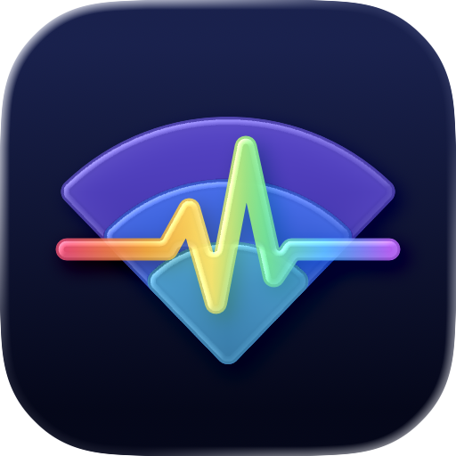

<p align="center"></p>

<h1 align="center">Wi-Fi Pulse</h1>

<p align="center">
  Always-on Wi-Fi and network monitoring for your Mac —<br>
  find out <em>where</em> it's slow: your Wi-Fi, your router, or your internet connection.
</p>

<p align="center">
  <strong>English</strong> · <a href="README.ja.md">日本語</a>
</p>

<p align="center">
  
  
  
  <a href="https://github.com/riku-mono/wifi-pulse/actions/workflows/l10n.yml"></a>
  <a href="LICENSE"></a>
</p>

> [!NOTE]
> Early development — 0.1.0 is not released yet. Builds are ad-hoc signed for local use only.

## Features

| Feature | What it does |
|---|---|
| **Always-on latency** | Pings your router and the internet (IPv4 / IPv6) side by side, so Wi-Fi delay and ISP delay show up separately |
| **Wi-Fi connection** | RSSI, noise, SNR, channel, PHY mode and link rate (CoreWLAN), with DFS channel warnings |
| **Nearby Wi-Fi** | Spectrum view, per-channel congestion with a suggested channel, and a list of access points |
| **App traffic** | Per-app / per-process traffic, remote hosts, RTT and TCP retransmits (`nettop`) |
| **LAN devices** | Devices on your network from ARP, an offline OUI table and mDNS names |
| **Diagnostics** | Speed and responsiveness (RPM) via `networkQuality`, a bufferbloat test, and Wi-Fi events from the unified log |
| **History** | Per-minute summaries per network, with time-of-day trends and findings |
| **Menu bar** | Status at a glance; monitoring keeps running after you close the window |

Wi-Fi Pulse only reads. It never changes your router or Mac settings.

## Requirements

- macOS 27 or later
- Xcode 27 or later (Swift 6) to build

## Build and run

```bash
cd apps/macos
open WiFiPulse.xcodeproj            # then ⌘R in Xcode
```

<details>
<summary>From the command line</summary>

```bash
cd apps/macos
xcodebuild -project WiFiPulse.xcodeproj -scheme WiFiPulse \
  -configuration Debug -derivedDataPath build/DerivedData.noindex build
open build/DerivedData.noindex/Build/Products/Debug/WiFiPulse.app

# Unit tests
xcodebuild -project WiFiPulse.xcodeproj -scheme WiFiPulse \
  -configuration Debug -derivedDataPath build/DerivedData.noindex test
```

</details>

Architecture and performance notes: [apps/macos/README.md](apps/macos/README.md) (Japanese).

<details>
<summary>Permissions</summary>

| Permission | Used for | Without it |
|---|---|---|
| Location | SSID, BSSID and beacon details (macOS requires Location for these) | No network name, BSSID, vendor or channel utilization |
| Local Network | The LAN device list | The device list stays empty |

</details>

<details>
<summary>Your data</summary>

Measurements are stored as JSON Lines in `~/Library/Application Support/WiFiPulse/` (you can change this in Settings).
They include MAC addresses and device names, so be careful when sharing them.

</details>

## Languages

English (source language) and Japanese. The app follows your system language by default; you can override it in Settings › General › Language.
Strings live in String Catalogs (`.xcstrings`) — see [docs/localization.md](docs/localization.md).

<!-- l10n-coverage:start -->
| Language | Translated | Coverage | Needs review | Untranslated |
|---|---:|---|---:|---:|
| `en` (source) | 542 / 542 | ██████████ 100.0% | 0 | 0 |
| `ja` | 542 / 542 | ██████████ 100.0% | 0 | 0 |

Catalogs: `apps/macos/WiFiPulse/InfoPlist.xcstrings`, `apps/macos/WiFiPulse/Localizable.xcstrings` (excluding 32 strings marked “don't translate” and 0 stale strings)
<!-- l10n-coverage:end -->

## Distribution

Some features (`nettop`, the unified log, running system commands) cannot run inside the App Sandbox, so Wi-Fi Pulse can't ship on the Mac App Store.
The plan is direct distribution with Developer ID signing and notarization — see [docs/distribution.md](docs/distribution.md).

## Repository layout

```
wifi-pulse/
├── apps/
│   ├── macos/      macOS app (SwiftUI, Xcode project)
│   └── web/        Landing page and web sample (planned)
├── assets/         App icon renders for the README and website
├── docs/           Distribution and localization notes
└── scripts/        Development scripts (localization coverage, etc.)
```

## Roadmap

- [ ] Remaining unit tests: network switching ([#2](https://github.com/riku-mono/wifi-pulse/issues/2))
- [x] App icon ([#3](https://github.com/riku-mono/wifi-pulse/issues/3))
- [ ] CI: build and test on macOS ([#4](https://github.com/riku-mono/wifi-pulse/issues/4))
- [ ] Developer ID signing, notarization and automatic updates ([#5](https://github.com/riku-mono/wifi-pulse/issues/5))
- [ ] `apps/web`: landing page and web sample

## Contributing

See [CONTRIBUTING.md](CONTRIBUTING.md). To report a security issue, see [SECURITY.md](SECURITY.md).

## License

The source code is licensed under the [Apache License 2.0](LICENSE).

The name “Wi-Fi Pulse” and the app icon are **not** covered by it — they remain © riku-mono, all rights reserved.
If you distribute a fork, give it your own name and icon. See [TRADEMARKS.md](TRADEMARKS.md) and [NOTICE](NOTICE).
